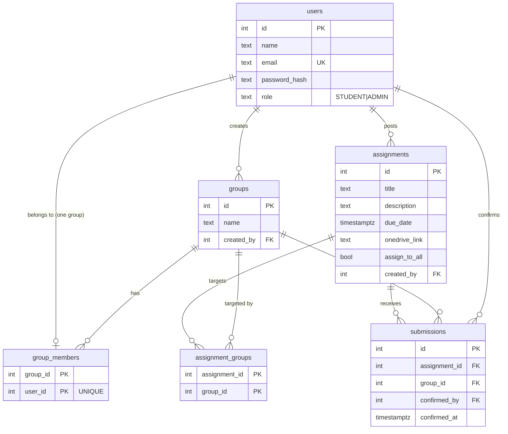

# Joineazy – Student, Group & Assignment Management System

Role-based web app where students form groups and confirm OneDrive submissions, and professors post assignments and track progress.

**Stack:** React (Vite) + Tailwind + Recharts · Node.js + Express · PostgreSQL · JWT · Docker
## Live Demo

- **Frontend:** https://joineazy-assignment-system-kt2f1cyod-sach15.vercel.app
- **Backend:** https://joineazy-assignment-system.onrender.com
- **GitHub Repository:** https://github.com/sachtayal/joineazy-assignment-system

The application has been deployed and tested with student and professor login, group creation, assignment management, submission confirmation, and progress tracking.

## Features
- **Student:** register/login, create a group, add/remove members by email or ID, view assignments and OneDrive links, two-step confirmation ("Yes, I have submitted" → "Confirm submission"), group progress bar, per-assignment badges.
- **Professor (Admin):** create/edit assignments (title, description, due date, OneDrive link), assign to all groups or chosen groups, group-wise and student-wise status, overview dashboard with bar/pie charts and per-group progress.

## Run with Docker
```bash
docker compose up --build
```
App: http://localhost:3000 · API: http://localhost:5000/api/health

Seeded accounts (created automatically on first start):
| Role | Email | Password |
|---|---|---|
| Professor | prof@joineazy.test | Admin@123 |
| Students | aarav / diya / kabir / meera / rohan / sara `@student.test` | Student@123 |

New professors can register with the access code from `ADMIN_SIGNUP_CODE` (default `prof-secret`).

## Run locally without Docker
```bash
# backend
cd backend && cp .env.example .env && npm install && npm run dev
# frontend (new terminal)
cd frontend && npm install && npm run dev      # http://localhost:5173, proxies /api to :5000
```
Needs a running PostgreSQL; set `DATABASE_URL` in `backend/.env`. Tables and seed data are created on startup.

## Environment variables
| Var | Where | Purpose |
|---|---|---|
| DATABASE_URL, JWT_SECRET | backend | DB connection, token signing |
| ADMIN_SIGNUP_CODE | backend | Code required to register as professor |
| ADMIN_EMAIL, ADMIN_PASSWORD | backend | Seeded professor |
| SEED_DEMO=false | backend | Skip demo students |
| CORS_ORIGIN | backend | Frontend origin in production |
| DATABASE_SSL=true | backend | For hosted Postgres that needs SSL |
| VITE_API_URL | frontend build | API base, e.g. `https://api.example.com/api` (default `/api`) |

## API (all under `/api`, JWT in `Authorization: Bearer <token>`)
| Method & path | Role | Description |
|---|---|---|
| POST /auth/register | public | `{name,email,password,role?,adminCode?}` |
| POST /auth/login | public | returns `{token,user}` |
| GET /auth/me | any | current user |
| GET /groups/mine | student | my group, members, progress |
| POST /groups | student | `{name}` create group (creator auto-joins) |
| POST /groups/:id/members | student | `{identifier}` email or numeric ID |
| DELETE /groups/:id/members/:userId | student | leave, or creator removes member |
| GET /assignments | student | assignments for my group, with confirmation state |
| POST /assignments/:id/confirm | student | `{confirm:true}`; one confirmation per group |
| GET /admin/assignments | admin | list |
| POST /admin/assignments | admin | `{title,description,due_date,onedrive_link,assign_to_all,group_ids}` |
| PUT /admin/assignments/:id | admin | edit |
| GET /admin/assignments/:id/status | admin | group-wise and member-wise status |
| GET /admin/groups | admin | groups for the picker |
| GET /admin/analytics | admin | totals, per-assignment and per-group completion |

## Database schema


## Architecture
```
React SPA ──fetch + JWT──▶ Express (routes → middleware auth/role → pg queries) ──▶ PostgreSQL
 (nginx in Docker; /api proxied to backend)
```
- `backend/src/routes/*` split by domain; `middleware/auth.js` verifies JWT and enforces role.
- Schema is applied from `schema.sql` on startup (idempotent), then seed data.
- Frontend: `App.jsx` holds auth state and role-based routes; pages are `Auth`, `Student`, `Admin`.

## Key design decisions
- **Confirmation is per group, not per student.** The brief says "group's progress"; one `submissions` row per (assignment, group), enforced by a UNIQUE constraint. `confirmed_by` records which member confirmed, so the professor still sees who did it. The student-wise view shows every member with their group's status.
- **A student belongs to one group** (`UNIQUE(user_id)` on `group_members`), which keeps progress unambiguous.
- **Server-side authorization:** only members confirm for their group, only for assignments targeted at it; only admins reach `/admin/*`; professor registration needs an access code.
- **Two-step confirmation** is enforced in the UI and the API requires `confirm: true`.
- **Deployment:** Frontend hosted on Vercel, backend hosted on Render, and PostgreSQL hosted on Render. The frontend uses `VITE_API_URL` to connect to the backend API.
